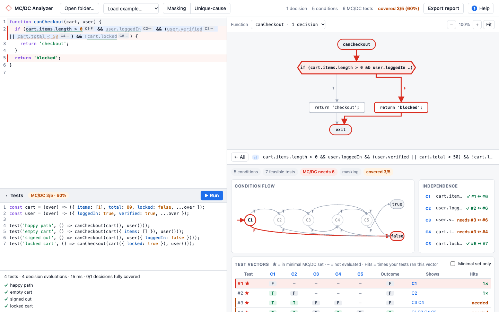
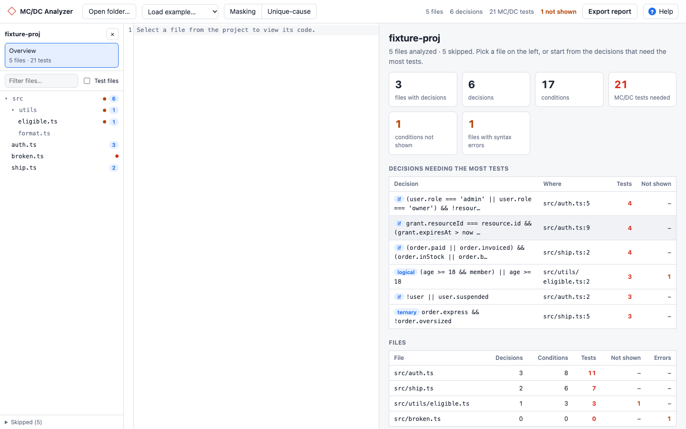

# MC/DC Analyzer

[](https://github.com/arjayosma/mcdc-analyzer/actions/workflows/ci.yml)
[](LICENSE)

**Find the smallest set of tests that proves every condition in your JavaScript or TypeScript actually matters, then measure how many of them you have.**

Paste a function or open a whole folder. For every `if`, loop, ternary and `&&` / `||`, MC/DC Analyzer works out which tests you need, traces each one through your code, runs your test calls to measure real coverage, and exports a shareable report with a ready-made AI prompt for the missing tests. Everything runs in your browser; your code never leaves your machine.

**[Try the live demo →](https://arjayosma.github.io/mcdc-analyzer/)**



## Why MC/DC?

Line and branch coverage can report 100% while parts of a condition were never really tested. In

```ts
if (user.isAdmin || (user.isOwner && !doc.locked)) { … }
```

one test with an admin and one with a regular user run every line and take both branches, yet neither checks that `isOwner` or `!doc.locked` matters. **Modified condition/decision coverage** asks for tests showing that each condition, on its own, changes the outcome. It is required for the most critical avionics software (DO-178C Level A) and recommended for ISO 26262 ASIL D, and it is a great lens for any logic-heavy code: permissions, validation, pricing, feature flags.

## Features

- **Minimal test sets:** for every decision, the short-circuit-aware truth table, the independence pairs, and the fewest tests that cover them all ([masking](#masking-vs-unique-cause) or unique-cause MC/DC).
- **Traced paths:** pick a test and its route is drawn in red through the control-flow graph and the condition flow, and the code it runs is bolded.
- **Measured coverage:** write calls like `test('admin', () => canEdit(admin))` in the **Tests** panel and press Run. The code is instrumented and run in an isolated worker, and every evaluation is matched to its test vector, so you see exactly which tests are still **needed**.
- **Whole projects:** open or drag in a folder for a file tree, per-file counts and the decisions that need the most tests. `node_modules`, build output, `.gitignore`d paths and (optionally) test files are skipped.
- **Reports and AI prompts:** export one self-contained HTML file with click-to-trace, plus a prompt that asks an AI assistant to write only the missing tests.
- **Built-in help:** press `?` in the app.



## Quick start

You need [Node.js](https://nodejs.org/) 20.19 or newer (22 recommended).

```bash
git clone https://github.com/arjayosma/mcdc-analyzer.git
cd mcdc-analyzer
npm install
npm run dev
```

Open the URL Vite prints (usually http://localhost:5173), then pick **Load example… → Basic: 5 conditions** to look around.

Using [nvm](https://github.com/nvm-sh/nvm)? Run `nvm use` first; the repo pins Node 22 in `.nvmrc`.

## Using it

1. **Add code.** Paste a function or file, choose an example, or use **Open folder…** (or drag a folder onto the page).
2. **Pick a decision.** Click it in the list, click its hexagon in the graph, or click any underlined condition in the code.
3. **Read the tests.** The **Test vectors** table lists every feasible combination; ★ marks the minimal set. Click a row to trace it.
4. **Measure.** Write calls in the **Tests** panel under the editor and press **Run** (⌘/Ctrl+Enter). The Hits column, the code underlines and the toolbar show what your tests cover.
5. **Share.** **Export report** downloads an HTML file; **Copy prompt** in the report gives an AI assistant everything it needs to write the missing tests.

Example test code for the basic example:

```js
const cart = (over) => ({ items: [1], total: 80, locked: false, ...over });
const user = (over) => ({ loggedIn: true, verified: true, ...over });

test('happy path', () => canCheckout(cart(), user()));
test('empty cart', () => canCheckout(cart({ items: [] }), user()));
test('locked cart', () => canCheckout(cart({ locked: true }), user()));
```

The file's top-level functions and exports are in scope; in a project, files can import each other by relative path.

### Masking vs unique-cause

- **Masking** (default, accepted by DO-178C): other conditions may change between the two tests of a pair, as long as they cannot affect the outcome. Often needs fewer than N+1 tests.
- **Unique-cause**: only the condition under test may change (short-circuited conditions are "don't care"). Stricter.

Switch between them in the toolbar to compare.

## Development

```bash
npm run dev        # start the app with hot reload
npm run check      # typecheck + lint + tests: run this before pushing
npm run build      # production build into dist/
```

| Script | What it does |
| --- | --- |
| `npm run dev` | Vite dev server |
| `npm run check` | `typecheck`, `lint` and `test` in one go (what CI runs, plus the build) |
| `npm test` | Unit tests once (Vitest) |
| `npm run test:watch` | Unit tests in watch mode |
| `npm run typecheck` | `tsc --noEmit` |
| `npm run lint` | ESLint |
| `npm run build` | Typecheck and build the static site into `dist/` |
| `npm run preview` | Serve the built `dist/` locally |

The app is plain TypeScript with no UI framework, built with Vite. `dist/` uses relative paths, so it can be hosted from any static host or sub-path; every push to `main` deploys it to GitHub Pages.

### How it works

```
source ─► language adapter ─► program model ─► MC/DC engine ─► UI · HTML report
          (Babel for JS/TS)   decisions,        truth tables,      │
                              conditions, CFG   pairs, min. set    ▼
                                                          instrumented run (Web Worker)
                                                          ─► measured coverage
```

| Folder | Responsibility |
| --- | --- |
| `src/engine/` | Language-neutral boolean trees → short-circuit truth tables, independence pairs, minimal test sets |
| `src/adapters/javascript/` | Babel AST → decisions, conditions (exact source ranges) and per-function control-flow graphs |
| `src/model/` | The language-neutral program model and the `LanguageAdapter` interface |
| `src/cfg/` | Graph layout (elkjs) and example paths through the graph |
| `src/coverage/` | Instrumentation, the Web Worker test runner (Sucrase for TS/JSX) and matching runs to vectors |
| `src/project/` | Folder loading, `.gitignore` matching, file selection and project summaries |
| `src/report/` | Standalone HTML report, AI test prompt and the report's inline script |
| `src/ui/` | App shell, code pane, graphs, decision panel, tests panel, file tree, help |
| `tests/` | Vitest tests mirroring `src/` |

Want to add a language? The engine and UI never look at syntax: implement a `LanguageAdapter` (see [CONTRIBUTING.md](CONTRIBUTING.md#adding-a-language)).

## Limitations

- Measuring coverage runs your calls in the browser: npm packages can't be imported (project files can, and JSX gets a small React stand-in), decorators can be analyzed but not run, and existing Jest/Vitest suites aren't measured yet.
- In the control-flow graph, `throw` goes straight to exit and a `catch` is reachable from the start of its `try`.
- `switch` cases are branches, not MC/DC decisions; `??` and `?.` are treated as single conditions.
- Truth tables are capped at 1,024 rows per decision and projects at 2,000 files.

## Contributing

Issues and pull requests are welcome. [CONTRIBUTING.md](CONTRIBUTING.md) covers the setup, conventions and where things live.

## License

[MIT](LICENSE) © Arjay Osma
